<a href="https://gallowforge.github.io/ballast/home/?demo=1#gh-dark-mode-only"><picture><source media="(max-width: 767px)" srcset="docs/readme/hero-dark-phone.webp 2.835x"><source srcset="docs/readme/hero-dark.webp 2x">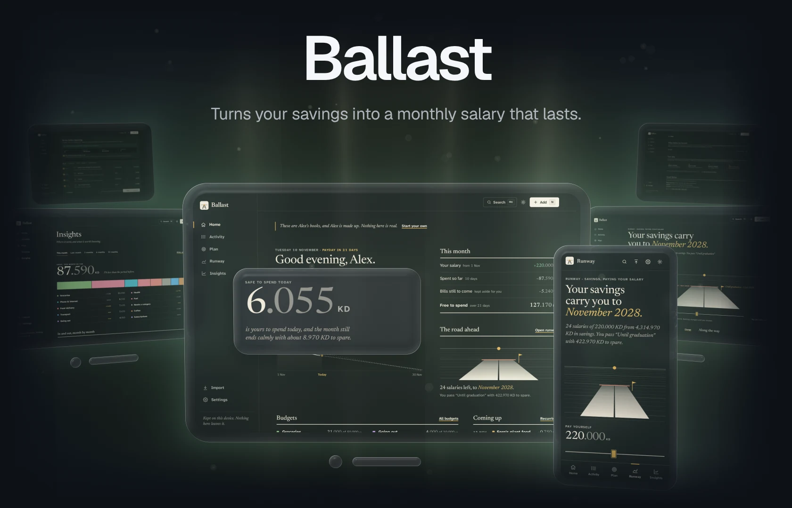</picture></a><a href="https://gallowforge.github.io/ballast/home/?demo=1#gh-light-mode-only"><picture><source media="(max-width: 767px)" srcset="docs/readme/hero-light-phone.webp 2.835x"><source srcset="docs/readme/hero-light.webp 2x">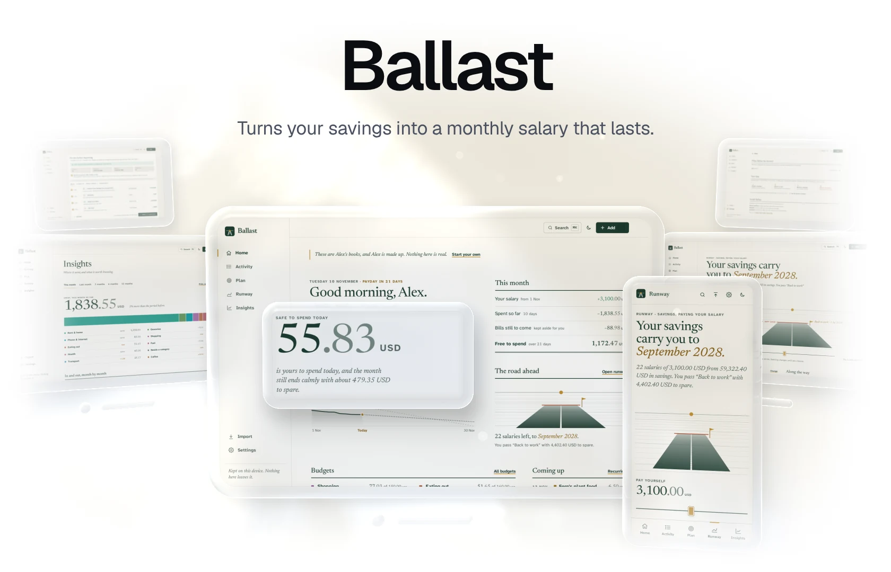</picture></a>

Living on savings is a guessing game: a banking app shows a balance, a budgeting app assumes a paycheck, and neither says how much you can spend today or whether the money lasts until the date you need. **Ballast pays you a fixed salary from your savings**, keeps the bills still to come aside, and tells you what is safe to spend today. It shows the month your savings would run out, years ahead, and the largest salary that still reaches your date. Bank statements are read on your device and checked row by row against the running balance. There is no account and no server, it works offline, and amounts in Kuwaiti dinars are exact to the fils.

**[Open the app](https://gallowforge.github.io/ballast/)** &nbsp;·&nbsp; [Try the demo](https://gallowforge.github.io/ballast/home/?demo=1) &nbsp;·&nbsp; [Quickstart](#quickstart) &nbsp;·&nbsp; [How it works](#how-it-works) &nbsp;·&nbsp; [Releases](https://github.com/gallowforge/ballast/releases)

<a href="https://github.com/gallowforge/ballast/actions/workflows/ci.yml#gh-dark-mode-only"><picture><source media="(max-width: 767px)" srcset="docs/readme/numbers-dark-phone.webp 2.835x"><source srcset="docs/readme/numbers-dark.webp 2x">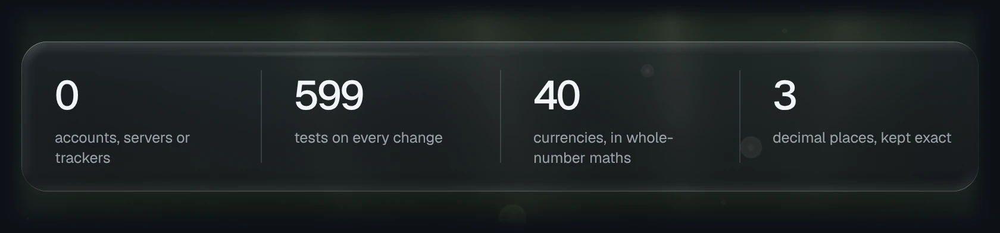</picture></a><a href="https://github.com/gallowforge/ballast/actions/workflows/ci.yml#gh-light-mode-only"><picture><source media="(max-width: 767px)" srcset="docs/readme/numbers-light-phone.webp 2.835x"><source srcset="docs/readme/numbers-light.webp 2x">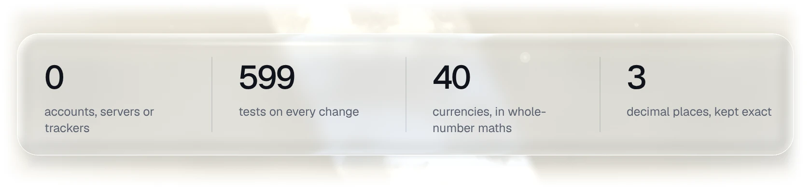</picture></a>

<br>

<a href="https://gallowforge.github.io/ballast/home/?demo=1#gh-dark-mode-only"><picture><source media="(max-width: 767px)" srcset="docs/readme/home-dark-phone.webp 2.835x"><source srcset="docs/readme/home-dark.webp 2x">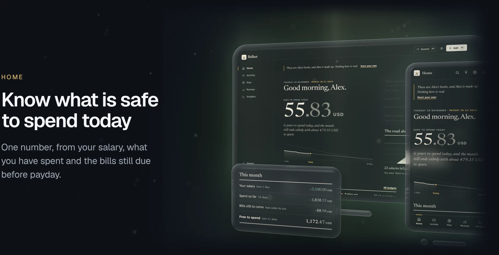</picture></a><a href="https://gallowforge.github.io/ballast/home/?demo=1#gh-light-mode-only"><picture><source media="(max-width: 767px)" srcset="docs/readme/home-light-phone.webp 2.835x"><source srcset="docs/readme/home-light.webp 2x">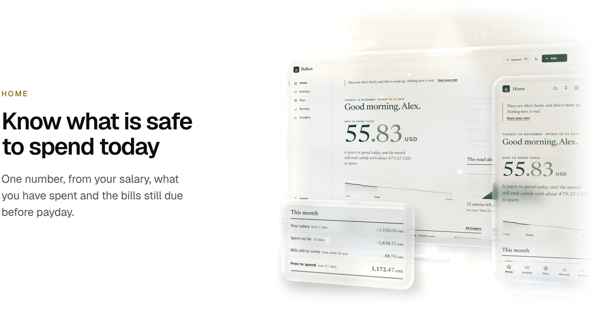</picture></a>

- **A month that follows your payday.** Pick any day from the 1st to the 28th. The salary moves from savings to spending on that day, and the month runs to the day before the next one.
- **Pace without the panic.** A burn-down line shows what is left against an even month, and a projection says how the month ends at your current pace. Fixed bills land on their own dates, so a gym membership on the 3rd never reads as overspending.
- **Budgets that show the line.** Each bar marks where an even pace would be today, flags "ahead of pace" early, and can roll unspent money into next month. A new budget suggests the average of your last three months.

<a href="https://gallowforge.github.io/ballast/runway/?demo=1#gh-dark-mode-only"><picture><source media="(max-width: 767px)" srcset="docs/readme/runway-dark-phone.webp 2.835x"><source srcset="docs/readme/runway-dark.webp 2x">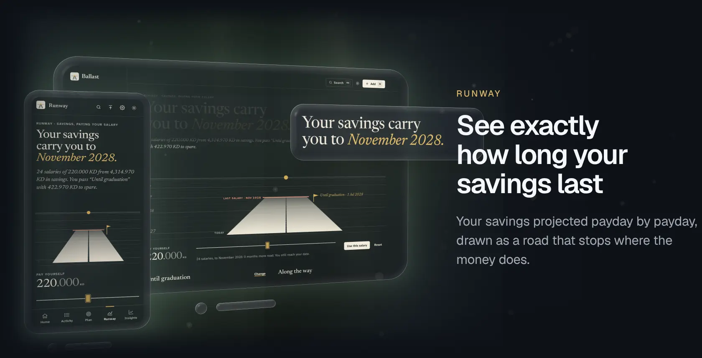</picture></a><a href="https://gallowforge.github.io/ballast/runway/?demo=1#gh-light-mode-only"><picture><source media="(max-width: 767px)" srcset="docs/readme/runway-light-phone.webp 2.835x"><source srcset="docs/readme/runway-light.webp 2x">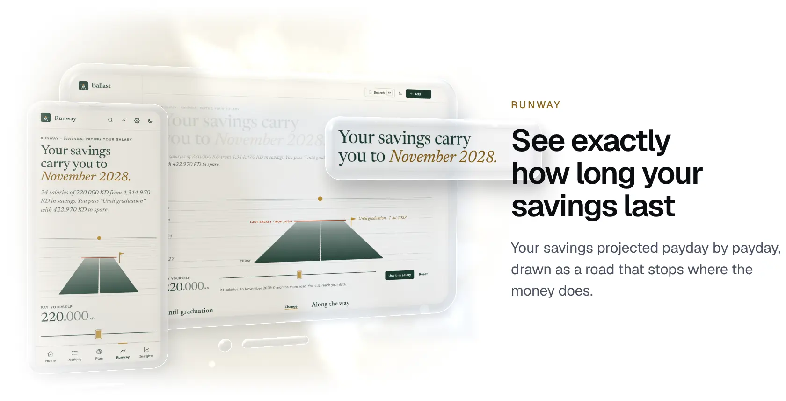</picture></a>

- **Salaries left, and the month they stop.** Every known income and yearly cost, payday by payday, counted in full paydays that keep you above a floor you choose. The exact staircase of figures sits under the road.
- **A date to reach.** Graduation, a new job, the month income starts again. Ballast says whether you get there and with how much to spare, or how many paydays short you fall.
- **The salary that gets you there.** The largest monthly amount that still reaches your date, and one tap to try it. Drag the salary and the road grows or shrinks while your flag stays put; nothing changes until you choose.

<a href="https://gallowforge.github.io/ballast/import/?demo=1#gh-dark-mode-only"><picture><source media="(max-width: 767px)" srcset="docs/readme/import-dark-phone.webp 2.835x"><source srcset="docs/readme/import-dark.webp 2x">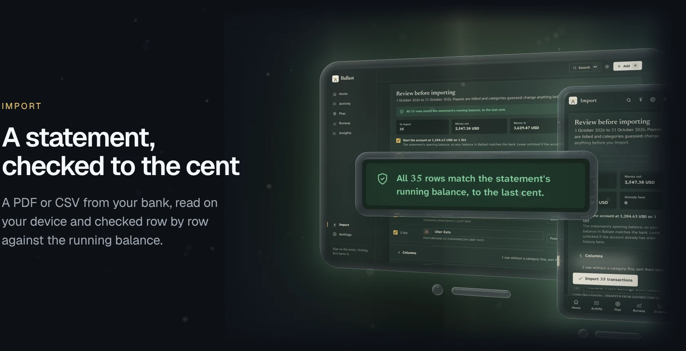</picture></a><a href="https://gallowforge.github.io/ballast/import/?demo=1#gh-light-mode-only"><picture><source media="(max-width: 767px)" srcset="docs/readme/import-light-phone.webp 2.835x"><source srcset="docs/readme/import-light.webp 2x">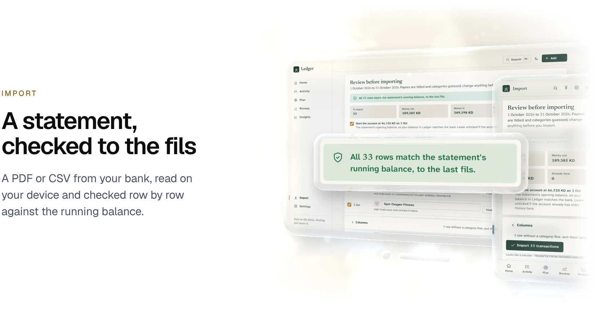</picture></a>

- **Every row checked.** Each line's balance must equal the one before plus its amount. When they all agree, nothing was misread, and Ballast says so; when some do not, it lists them, usually because a column was matched wrongly. Without signs on the amounts, the balance decides which way the money went.
- **Any bank.** National Bank of Kuwait statements are recognised, password-protected PDFs open on the device, and any other bank works through column matching. The account can start at the statement's opening balance, so Ballast and the bank show the same figure.
- **Never twice.** Overlapping statements add only what is new, and a line that matches something you entered by hand, or the salary Ballast moved itself, is left out. Every import undoes in one tap.
- **Tidy without effort.** Card numbers and terminal codes are stripped, common merchants recognised, and every correction becomes a rule for the next statement.

<a href="https://gallowforge.github.io/ballast/insights/?demo=1#gh-dark-mode-only"><picture><source media="(max-width: 767px)" srcset="docs/readme/insights-dark-phone.webp 2.835x"><source srcset="docs/readme/insights-dark.webp 2x">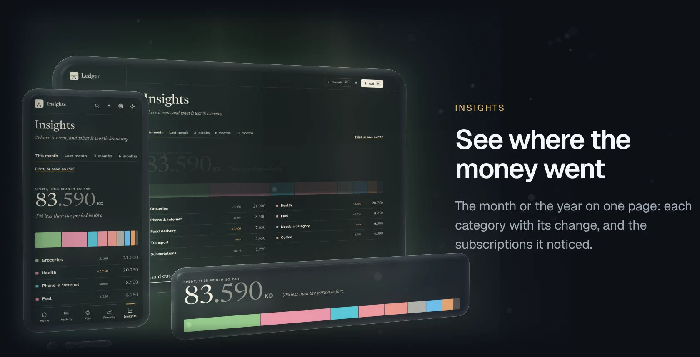</picture></a><a href="https://gallowforge.github.io/ballast/insights/?demo=1#gh-light-mode-only"><picture><source media="(max-width: 767px)" srcset="docs/readme/insights-light-phone.webp 2.835x"><source srcset="docs/readme/insights-light.webp 2x">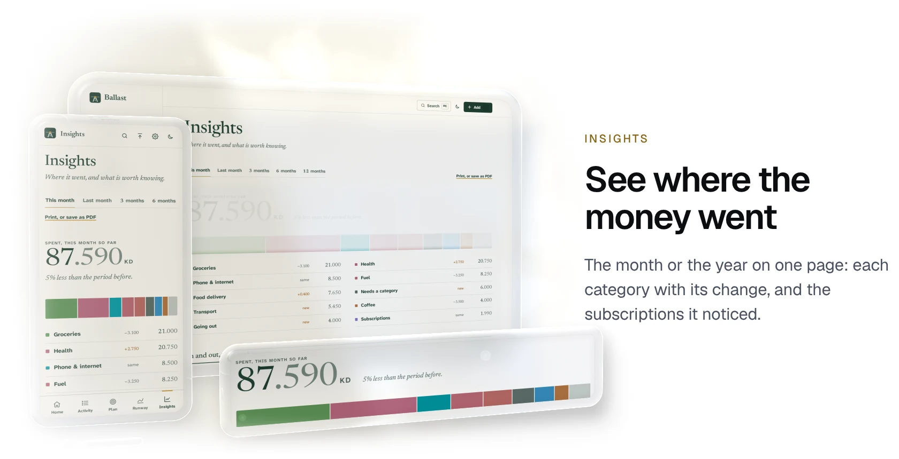</picture></a>

- **One page.** The month, or the last three, six or twelve: one strip of categories with the change from before, money in and out month by month, a calendar of every day's spending, the places you spend most, and the most expensive day of the week.
- **Plain observations.** Spending against the same point last month, the category that rose most, a purchase much bigger than usual, how much of last month's income you kept. Each needs enough data to be fair.
- **Subscriptions it notices.** Payments that repeat at a steady amount and interval are spotted in your history, with price rises called out. One tap tracks them. Print the page, or save it as a PDF.

<a href="https://gallowforge.github.io/ballast/privacy/#gh-dark-mode-only"><picture><source media="(max-width: 767px)" srcset="docs/readme/privacy-dark-phone.webp 2.835x"><source srcset="docs/readme/privacy-dark.webp 2x">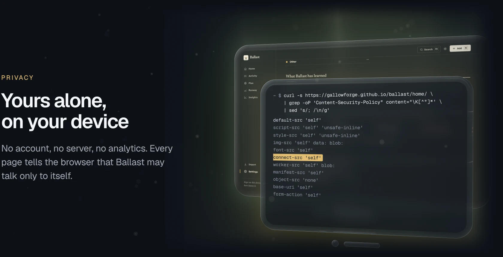</picture></a><a href="https://gallowforge.github.io/ballast/privacy/#gh-light-mode-only"><picture><source media="(max-width: 767px)" srcset="docs/readme/privacy-light-phone.webp 2.835x"><source srcset="docs/readme/privacy-light.webp 2x">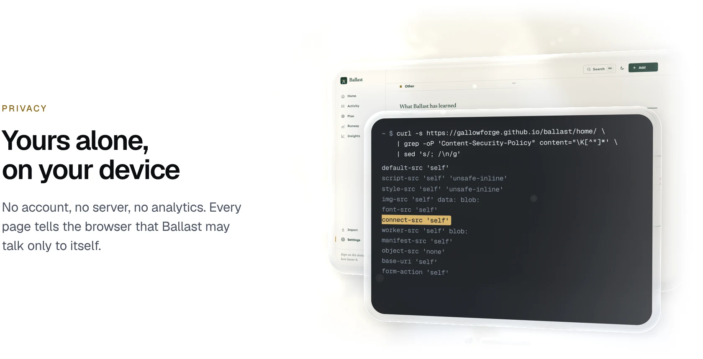</picture></a>

- **Nothing to connect to.** Every page carries a Content Security Policy with `connect-src 'self'`, so the browser blocks any connection to another site. There is no exchange-rate service either: rates are what you enter.
- **Offline from the first visit.** A service worker caches every built file on the first load, including the PDF reader, so even statement import works with no connection.
- **Export, restore, delete.** A full backup as one JSON file, transactions as CSV, restore by replacing or merging, and one button that deletes everything from the device.

## Why it is different

|                   | Ballast                                  | Typical money apps                   |
| ----------------- | ---------------------------------------- | ------------------------------------ |
| Account           | None                                     | Required                             |
| Your data         | On your device only                      | On their servers                     |
| Bank statements   | Read on the device, checked row by row   | A bank login handed to a third party |
| Living on savings | A salary, a runway and a target date     | Not modelled                         |
| Kuwaiti dinar     | Exact to the fils, in whole-number maths | Often floats, often two decimals     |
| Offline           | Everything, including statement import   | Read-only, or nothing                |
| Price             | Free and open source                     | A subscription                       |

## Quickstart

**Use it.** Open [gallowforge.github.io/ballast](https://gallowforge.github.io/ballast/) and install it: in Safari on iPhone and iPad, **Share**, then **Add to Home Screen**; in Chrome on Android, **Install app** in the menu; in Chrome or Edge on a computer, the install icon in the address bar. It opens in its own window and works offline. Start in a minute with two balances, a salary and a date, import a statement, or explore five months of made-up demo data first.

**Run it.** Node 22 or newer:

```bash
git clone https://github.com/gallowforge/ballast.git && cd ballast
npm install
npm run dev        # http://localhost:4321
```

**Check it.** The same checks CI runs:

```bash
npm run verify                    # type check, unit tests, build and size budget
npx playwright install chromium   # once, for the end-to-end suite
npm run test:e2e                  # Playwright on desktop and phone
```

Every push to `main` deploys to GitHub Pages. The build works at the root of a domain or under a sub-path: set `SITE_URL`, and `BASE_PATH` when not at the root.

## How it works

Every calculation is a pure function in [`src/lib`](src/lib) with tests beside it, and the [how-it-works page](https://gallowforge.github.io/ballast/about/) explains each in plain words.

| Question            | Method                                                                                                                                                                                                                                                              |
| ------------------- | ------------------------------------------------------------------------------------------------------------------------------------------------------------------------------------------------------------------------------------------------------------------- |
| Money               | Integers of the minor unit (fils, cents) from ISO 4217 exponents. Exchange rates kept as decimal strings and applied with BigInt, rounded once, half away from zero.                                                                                                |
| Currencies          | Accounts in any of 24 currencies; a purchase can record the foreign amount next to what the bank charged. Rates are entered in Settings and never fetched, and each transaction keeps its value in your main currency at the time, so old entries are not revalued. |
| Your month          | Runs from your payday (1st to 28th) to the day before the next one, with short months clamped.                                                                                                                                                                      |
| Safe to spend       | (Salary + money in − spent − recurring bills still due this month) ÷ days left, on your spending accounts.                                                                                                                                                          |
| Pace and projection | Everyday spending against an even spread of the month's flexible money; recurring bills excluded on both sides. The projection runs your everyday average to month end.                                                                                             |
| Runway              | Savings balance, minus the salary on each payday, plus recurring income into savings, minus recurring costs from savings, stopping at zero. Without a salary: the average net outflow of the last three full months.                                                |
| Largest salary      | (Savings − floor + income − costs until the date) ÷ paydays until the date, floored to the fils.                                                                                                                                                                    |
| Budgets             | Spent in the category this month against the amount plus any rollover; "ahead of pace" past 110% of an even month once a tenth is used.                                                                                                                             |
| Subscriptions       | The same payee three or more times, the latest amounts within 10%, and every gap within 15% of a week, a month or a year; still active and not already tracked.                                                                                                     |
| Statement tables    | pdf.js text runs grouped into lines by position; cells placed under headings by right edge for amounts and by order for dates; wrapped descriptions joined to the line above; without headings, number columns found by clustering right edges.                     |
| Columns and values  | Header synonyms (NBK's layout first) or content inference; day-first, month-first or ISO dates; 1,234.567 or 1.234,56; minus, trailing minus, brackets, DR and CR.                                                                                                  |
| Reconciliation      | Each row's balance equals the previous balance plus its amount, checked oldest first even for newest-first statements. Unsigned amounts take their sign from the balance.                                                                                           |
| Duplicates          | Fingerprint of account, date, signed amount and description, numbered within a statement; entries without one matched by amount within three days, each claimed once.                                                                                               |

<details>
<summary><b>The flow, as a diagram</b></summary>
<br>

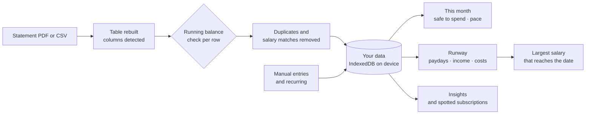

</details>

<details>
<summary><b>Privacy, by construction</b></summary>
<br>

Ballast is static HTML and JavaScript with no backend. Your data lives in this site's IndexedDB storage in your browser, and Ballast asks the browser to keep it even when space runs low. If the page closes while a save is still in flight, a synchronous copy is kept and picked up on the next visit. The Content Security Policy allows connections only to the site itself, and there are no cookies, analytics, third-party fonts or scripts. Statement files are read in the tab and not kept; a statement password is used once and never stored. Settings exports, restores and deletes everything.

</details>

<details>
<summary><b>Stack and architecture</b></summary>
<br>

[Astro](https://astro.build) static output with page transitions, [Preact](https://preactjs.com) islands, [Tailwind CSS v4](https://tailwindcss.com), strict TypeScript, [pdf.js](https://mozilla.github.io/pdf.js/) for statements, Vitest, Playwright with axe, and Lighthouse CI. Newsreader (figures and headings) and Atkinson Hyperlegible Next (words) are self-hosted, Latin only. A post-build step adds `modulepreload` links so each page fetches its scripts in parallel, and writes the service worker with a content-hashed version and the full precache list.

```
src/
  lib/money/      currencies, exact minor-unit maths, exchange rates
  lib/calc/       money month, salary and safe-to-spend, budgets, recurring, runway,
                  insights and subscription detection, statistics (all with tests)
  lib/import/     CSV, statement values, column detection, PDF layout, reconciliation,
                  payee cleanup, categories, duplicates, bank profiles
  lib/store/      pure operations, IndexedDB persistence, undo
  lib/            dates, backups, demo data, quick add, icons
  components/     Preact screens, charts (the road, runway staircase, burn-down,
                  cash flow, calendar), the add sheet, launcher and toasts
  pages/          every route
  sw/             service worker template
tests/e2e/        Playwright suites; tests/fixtures holds the synthetic statements
scripts/          post-build step, size budget, fixtures, icons
docs/DESIGN.md    the identity: one idea, voice, type, colour, motifs, what is banned
docs/readme/src/  the README's Glass scenes: captures, layouts and the renderer
```

</details>

<details>
<summary><b>The look, and why</b></summary>
<br>

One idea runs through every screen: a calm runway, with your money laid out as a road that ends on a date. The ground it crosses is ruled like ledger paper, because the other half of the idea is an honest column of figures, exact to the fils.

- **Colour, 60/30/10.** Warm paper, ink green, and brass spent like money: today's marker, the target flag, the sun on the horizon. Leaf green is kept for money coming in and clay for going over a line; spending is ink, never alarm red. A night ledger theme follows the system.
- **Two typefaces, each with a job.** Newsreader sets every figure and heading, with tabular lining numerals so money lines up on the decimal point and the fils a step lighter than the dinars. Atkinson Hyperlegible Next, designed for readers with low vision, sets the words.
- **Account-book habits.** Lists sit on hairline rules, totals get the accountant's double rule, and labels are small capitals like a ledger's column heads.
- **A calm, kind voice.** It says what is true, then what to do, without blame or exclamation marks. An empty list is "A clean page", not an error.

The full identity is in [docs/DESIGN.md](docs/DESIGN.md).

</details>

<details>
<summary><b>Keyboard shortcuts</b></summary>
<br>

| Key             | Does                                            |
| --------------- | ----------------------------------------------- |
| `N`             | Add a transaction                               |
| `⌘K` / `Ctrl+K` | Quick launcher: pages, actions and transactions |
| `/`             | Search (on Activity)                            |
| `←` / `→`       | Step through the runway chart when it has focus |
| `Esc`           | Close a sheet                                   |

</details>

## Quality

[](https://github.com/gallowforge/ballast/actions/workflows/ci.yml) [](LICENSE)

| Check                 | What it covers                                                                                                                                                                                                                                                                                                                                                                                        |
| --------------------- | ----------------------------------------------------------------------------------------------------------------------------------------------------------------------------------------------------------------------------------------------------------------------------------------------------------------------------------------------------------------------------------------------------- |
| 371 unit tests        | Money and exchange rates, dates and money months, recurring items, safe-to-spend and pace, budgets with rollover, runway and target salary, insights, CSV, PDF layout, statement parsing and reconciliation, duplicates, categories, the store, backups and demo data. Coverage above 90% of lines.                                                                                                   |
| 112 end-to-end tests  | 57 scenarios on a desktop browser and 55 on a phone (the two keyboard shortcuts are desktop only): first run, moving between pages, quick add, edit and undo, transfers, search, the launcher, runway what-if, budgets, PDF, CSV and password-protected imports, re-import, undo import, backup and restore, CSV export, offline use, and an axe accessibility sweep of every page in light and dark. |
| Lighthouse CI         | Ten pages on desktop and four on a simulated phone, asserted at 95 and 90. Measured locally: 100 on desktop across performance, accessibility, best practices and SEO; on a phone, 92 to 96 for performance and 100 for the rest.                                                                                                                                                                     |
| JavaScript budget     | Every page's scripts followed through their imports and summed gzipped: under 12 KB for the site pages, under 65 KB for the app (the largest is 58 KB). The PDF reader loads only when a PDF is chosen.                                                                                                                                                                                               |
| Type check and format | `astro check` in strict mode and Prettier across the tree.                                                                                                                                                                                                                                                                                                                                            |

The images in this README are real screens of the built app with its demo data, captured fresh in the dark theme and the light one and set in glass by a small WebGL renderer: `npm run readme:visuals` rebuilds every one ([`docs/readme/src`](docs/readme/src)). The runway animation is the real salary slider, captured frame by frame. The sample statements in `tests/fixtures` (and the "Try a sample" buttons) are made up and come from `npm run fixtures`.

## FAQ

<details>
<summary><b>Is it really free?</b></summary>
<br>
Yes. There is no account, paywall or premium tier. It is a static site, which costs nothing to run.
</details>

<details>
<summary><b>Where does my data go?</b></summary>
<br>
Nowhere. It stays in your browser on your device. Clearing the site's data removes it, so export a backup from Settings now and then.
</details>

<details>
<summary><b>Will it read my bank's statements?</b></summary>
<br>
National Bank of Kuwait statements are recognised by name. Any other bank's PDF or CSV works through column matching: the columns are detected for you and can be changed before import. Scanned statements, which are pictures with no text in them, cannot be read, and Ballast says so.
</details>

<details>
<summary><b>Can I use it on my phone and my computer?</b></summary>
<br>
Yes, but the two do not sync, since nothing goes through a server. Export a backup on one and restore it on the other, choosing to replace or to add what is new.
</details>

<details>
<summary><b>Is this financial advice?</b></summary>
<br>
No. Ballast is arithmetic on the numbers you give it. It does not know your circumstances, and its projections are only as good as the figures entered.
</details>

<details>
<summary><b>Why is it called Ballast?</b></summary>
<br />
Ballast is the weight low in a ship's hull that keeps it upright in rough water. Savings paid out as a steady salary do the same for a life between incomes. Until version 1.1 it was called Ledger. If you used it then, open the new address once: your data is still there, and old backups restore as before.
</details>

## Contributing

Issues and pull requests are welcome: run `npm run verify` and `npm run test:e2e` first, and send statement layouts from other banks as made-up fixtures that follow the real layout, never real statements.

## Licence

[MIT](LICENSE). Third-party components and their licences are listed in [THIRD-PARTY.md](THIRD-PARTY.md).
